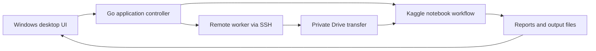

# EDIORA Match

**Area:** Video processing, transcription-oriented workflows, Windows desktop software and cloud automation  
**Project type:** Personal software project / technical case study  
**Evidence level:** Source-code inspection and selected automated local tests. No native Windows end-to-end test in this review.

## Problem and approach

EDIORA Match aims to reduce manual work in long-form media workflows by coordinating input, processing, editing/review and output handling.

The inspected source archive contains a Go desktop application, browser-based UI assets, Python processing modules, cloud transport components and automated tests.

## Architecture visible in the source

**Representative source modules reviewed (not publicly uploaded):**

- `desktop/main.go`, `desktop/cloud.go`, `desktop/automatic.go`: application and cloud workflow orchestration.
- `desktop/ui/`: user interface and state presentation.
- `desktop/assets/oracle_cloud.py`: remote download and upload orchestration.
- `kaggle/cloud_io.py`, `kaggle/video_worker.py`, `kaggle/mode7_core.py`: cloud input, editing/processing and content-selection logic.
- `tests/` and `desktop/*_test.go`: test cases included with the project.

## Engineering practices demonstrated

- Separation of desktop controls, cloud transport and processing modules.
- Automated tests around transfer progress, resume behavior, validation, credential handling and topic-duration rules.
- Tests for data validation including duplicate clip entries and unsafe manifest paths.
- UI regression-testing scripts and a versioned source archive.

## Evidence

Read the [test results and known limitations](ediora-match-test-results.md). The local review found **14 selected Python tests passing** and **1 JavaScript regression test passing**; two additional JavaScript tests failed during this review. This is **not** a claim that the entire application passes all tests.

## What still needs live verification

- Clean-install and end-to-end execution on Windows.
- Actual download, Drive upload, Kaggle job and final MP4 round-trip with safe test data.
- Recovery from a real SSH interruption, without duplicate remote jobs.
- Accurate progress indication during live download/upload.
- Performance and reliability across different machines and network conditions.

**Demo status:** Not yet published. A real screen recording with credentials hidden is planned; no simulated success is presented as proof.

[Back to all projects](README.md)
