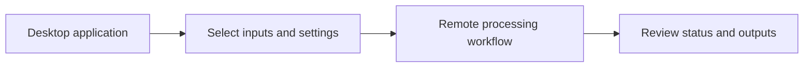

# EDIORA Studio

**Area:** Windows desktop media workflow automation  
**Artifact reviewed:** `EDIORA_Studio_Mode4_PRO_v4_1.exe` (Windows x64 executable)  
**Evidence level:** Executable file and embedded-text inspection only.

## Project overview

EDIORA Studio is a desktop application project oriented toward coordinating media/processing jobs. Inspection of the supplied Windows executable found references to Oracle/SSH, Kaggle, Python, yt-dlp and FFmpeg-related operations. These are indications of integrated workflow components—not proof that every operation succeeds in a live deployment.

## Intended workflow

## Portfolio demonstration plan

- Record the actual Windows application launch and navigation.
- Run a small authorized sample from input to output, with credentials and private URLs hidden.
- Show the resulting file and verify it plays correctly.
- Record error-handling and recovery behavior during a controlled failure.
- Preserve source-code snapshots and meaningful test results for a future engineering review.

## Verification limits

No editable source package for this exact Studio executable was available in the current review. The app was **not** launched on Windows and no live cloud operation was performed. Therefore code quality, runtime reliability and output quality remain **unverified** here.

[Back to all projects](README.md)
